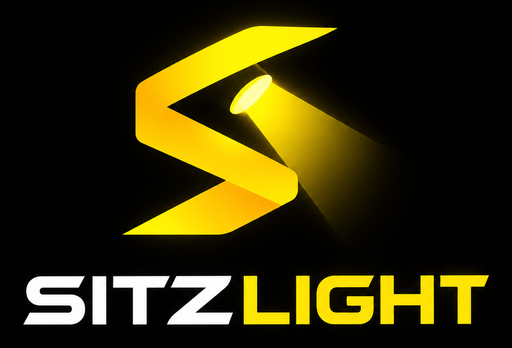

# Sitz Light – Downloads

Sitz Light ist eine Lichtsoftware für mobile DJs: Ein Auto-Director fährt eine
beat-synchrone Lichtshow, du wählst nur Stimmung und Intensität und greifst bei
Bedarf live ein. Bedienung am Rechner, im Browser und am iPad/iPhone.

> **Proprietäre Software. © Markus Sitzmann, alle Rechte vorbehalten.**
> Dieses Repository enthält ausschließlich fertige Installer, Signaturen und
> Versionsinformationen für die automatische Update-Funktion. Es enthält keinen
> Quellcode. Die Nutzung, Weitergabe, Veränderung oder Zerlegung der Software ist
> ohne ausdrückliche schriftliche Erlaubnis nicht gestattet.

## Unterstützte Systeme

| System | Voraussetzung |
|---|---|
| Windows | Windows 10 oder 11, 64 Bit |
| macOS (Apple Silicon) | ab macOS 12 Monterey, M1 oder neuer |
| macOS (Intel) | ab macOS 12 Monterey, z. B. MacBook Pro ab 2015 |
| iPad / iPhone / Browser | als Fernbedienung im selben Netz, Safari ab 15 |

## Download und Installation

Die aktuelle Version findest du unter **[Releases](../../releases/latest)**.
Testversionen sind dort als „Pre-release“ markiert.

- **Windows:** `…-windows-x64.msi` herunterladen und doppelklicken. Erscheint
  „Der Computer wurde durch Windows geschützt“, auf „Weitere Informationen“ →
  „Trotzdem ausführen“ klicken. Beim ersten Start den Netzwerkzugriff erlauben.
- **macOS:** `…-macos-apple-silicon.dmg` bzw. `…-macos-intel.dmg` öffnen und
  „Sitz Light“ in „Programme“ ziehen. Beim ersten Start unter Systemeinstellungen
  → Datenschutz & Sicherheit → „Dennoch öffnen“ klicken.
- **iPad, iPhone, Browser:** keine Installation nötig. Die Adresse bzw. den
  QR-Code zeigt Sitz Light am Rechner unter „System → Webzugriff“.

**Updates:** Sitz Light bietet neue Versionen selbst an, nie während einer laufenden
Show und nie im Gig-Modus. Jedes Update ist signiert und wird vor der Installation geprüft.

## Empfohlenes Setup

Für das beste Zusammenspiel von Musik und Licht empfehlen wir drei Bausteine:

- **Ein eigener Router (oder Reise-Router) im Rack:** ein stabiles, eigenes Netz für den Licht-Rechner, den Art-Net-Node und das iPad. So bist du unabhängig vom WLAN der Location, das bei vollem Saal oft aussetzt. Den Licht-Rechner und den Node **per Kabel (LAN)** anschließen, das iPad per WLAN. Ein Mac ohne Netzwerkbuchse braucht dafür einen **USB-C-auf-LAN-Adapter**. Feste IP-Adressen für den Node vergeben (z. B. 192.168.2.50) und **nie die Broadcast-Adresse** des Netzes (meist die Endung .255) oder die Netzadresse (.0) verwenden.
- **Ein Audio-Interface für die Musikerkennung:** z. B. ein kleines USB-Interface am Booth- oder Rec-Ausgang des Mixers. Sitz Light erkennt daran Takt, Energie, Build-ups, Drops und Phrasen, auch ohne rekordbox. Den Pegel so einstellen, dass die Pegel-Ampel in Sitz Light grün zeigt. Bei Brummen ein Gerät mit Masse-Trennung (Ground-Lift oder DI-Box) dazwischen.
- **Ein Art-Net-Node** (Ethernet auf DMX) **oder ein galvanisch getrennter USB-DMX-Adapter** mit eigenem Prozessor (Enttec-DMX-USB-Pro-kompatibel). Der Node ist die robustere Wahl: Rechner und Lichtanlage sind elektrisch getrennt, das verhindert Brummen im Ton und schützt die Geräte. Am Node das Universe so einstellen, wie Sitz Light es unter DMX-Ausgabe anzeigt („am Node: Net · Subnet · Universe“).

**Empfohlene Taktquelle ist das Audio-Interface.** Die Anbindung an rekordbox über das Programm **rkbx_link** (eigenes Projekt, nicht Teil von Sitz Light) ist vorerst experimentell und wird später richtig eingebaut: <https://github.com/grufkork/rkbx_link>.

## Neu

### Version 0.11.1 (31.10.2026)

- **Ruhigerer Build-up**: Vor dem Drop baut das Licht die Spannung jetzt über Helligkeit, kräftiger werdende Farben und schneller werdende Moving Heads auf, statt über schnelles Geflacker. Eine Szene steigert sich bis zum Drop, statt alle paar Takte zu wechseln. Lichtblitze gibst du weiterhin selbst per Strobe-Knopf dazu.
- **Segmente zusammenfassen**: Bei Geräten mit mehreren Segmenten (z. B. LED-Bars) stellst du unter Geräte → Patch ein, wie viele Segmente zusammen leuchten. Standard: höchstens vier Blöcke je Gerät, das wirkt ruhiger.
- **Szenen-Vorschau**: Läuft die Show, zeigt das Licht eine neu hinzugefügte Szene nicht mehr von selbst. Mit ▶ fragt Sitz Light vorher, ob die laufende Show kurz unterbrochen werden soll.

### Version 0.11.0 (31.10.2026)

- **Genre**: Wähle im Live-Tab das Genre, das du gerade spielst (House, Dance & Pop, Party-Action, Classics, Hip-Hop / R&B, Latin, Schlager, Chill / Lounge, Hochzeit: Dinner / Sekt, Hochzeit: Eröffnungstanz). Das Licht übernimmt den Charakter der Musik: wie viel sich bewegt, wie oft Szenen wechseln, ob es pulsiert. Der Wechsel kommt sanft zur nächsten Phrase. Tasten Umschalt+1 bis Umschalt+9. Eigene Genres lassen sich unter Director → Genres anlegen.
- Die Show bleibt der Rahmen: Ein Genre macht das Licht nie heller, schneller oder wilder, als die Show erlaubt. Lichtblitze gibt es weiterhin nur per Strobe-Knopf.
- **Mover-Show**: Die Moving Heads rocken jetzt richtig ab, mit großen, abwechslungsreichen Bewegungen im Takt und einer neuen Bewegung je Phrase, immer im sicheren Bereich.
- **Wenig Energie = ruhiges Licht**: Wird die Musik sehr ruhig, blinkt nichts mehr, das Licht wechselt höchstens langsam die Farbe.
- **Farben im Live-Tab** wählbar, kleine „i“-Erklärungen überall im Director, ruhigere Gliederung, nichts bricht mehr um.
- **Lauflichter** lassen sich abschalten oder mit Start- und Endgerät festlegen.
- **Szenen-Vorschau**: Beim Zusammenstellen einer Show zeigt das Licht jede Szene kurz im Takt, auch ohne Musik.
- **20 neue Szenen**, vor allem ruhige und fließende für Build-up und Drop, dazu „Frequenz-Höhen“: Lampen unten folgen dem Bass, oben den Höhen (Höhe je Lampe im Patch einstellbar).
- **Akzentfarbe** jetzt Gelb wie das Logo, unter Einstellungen → Bedienung frei wählbar.
- Die Zurück-Taste der Maus (und Zurück am iPad) springt nur noch zwischen den Seiten und verlässt Sitz Light nie.
- In der Demo steht, wo es die Lizenz gibt: djsitz.com.

### Version 0.10.0 (26.10.2026)

- Das Tempo springt bei langsamen Songs nicht mehr auf ein verwandtes Tempo (zum Beispiel von 90 auf 145 BPM). Im Zweifel bleibt das bisherige Tempo.
- Neuer Schalter **Pulsieren** (aus, dezent, normal) und Modus **Mover-Show**: Pars und Bars leuchten ruhig im Hintergrund, die Moving Heads machen die Show.
- Jede Show hat eine **Drop-Empfindlichkeit**: Bei „Hochzeit klassisch“ gibt es den Licht-Treffer nur bei klaren Drops und sanfter, bei „Club“ auch bei schwächeren.
- Weniger Licht-Treffer an falscher Stelle, vor allem in Strophen von Pop- und Hip-Hop-Songs.
- Kommt ein Liedteil wieder (zum Beispiel der zweite Refrain), kommen auch dieselben Szenen wieder. Im Build-up steigert sich das Licht bis zum Drop.
- „Hochzeit klassisch“ darf bis 100 % hell werden.
- **Licht-Offset mit Testblitz**: Ein kurzer weißer Blitz auf jedem Beat hilft, das Licht genau auf die Kick einzustellen.
- Keine automatischen Lichtblitze mehr: Blitze gibt es nur noch, solange du den Strobe-Knopf drückst. Auch vor dem Drop blitzt nichts mehr von allein.
- Im Modus „Gemischt“ bleibt deine Phrase von Hand mindestens 8 Takte und danach bis zur nächsten erkannten Phrase. Unter den Knöpfen steht, dass gerade deine Wahl gilt.
- Die Liedteile wechseln deutlich ruhiger: Ein neuer Teil gilt erst, wenn er sich bestätigt hat, und bleibt dann eine Weile. Solange es unklar ist, bleibt das Licht, wie es ist. Build-ups werden öfter erkannt.
- **Live neu**: der Director groß in der Mitte mit Liedteil, Szene, Phrase, „Drop bereit“ und „Deine Wahl“ auf einen Blick; links der Simulator, rechts Takt und Musik. Am Handy lassen sich Simulator und Musik aufklappen.
- Ruhigere Oberfläche: keine umbrechenden Knöpfe und Zahlen mehr, lange Namen enden mit „…“ und zeigen sich beim Antippen ganz. Nichts ragt mehr aus den Karten.
- Im Programmfenster lassen sich alle Dateien wieder speichern (Diagnosepaket, Konfiguration, Gelerntes, Aufnahmen, Exporte). Sie landen im Ordner „Downloads“, ein Hinweis zeigt sie im Ordner.
- Gelerntes lässt sich jetzt auch **importieren**, zum Beispiel vom Laptop auf den Licht-Rechner. Doppeltes zählt nur einmal.

## Als Nächstes geplant

- **Liedteile noch genauer**: weniger Drops an falscher Stelle, Intro und Outro besser erkennen.
- **Lernen überarbeiten**: Korrekturen von Hand wirken noch gezielter auf die Erkennung der Liedteile.
- **3D-Bühnenplan**: Lampen auf einem Plan platzieren, Moving Heads grafisch einrichten (Zielpunkte, sichere Bereiche, gesperrte Bereiche), mit einfacher 2D-Ansicht als Rückfall.
- **Mehr Ausfallsicherheit**: Programmfenster startet nach einem Fehler neu, ohne dass die Show stoppt; Fernbedienungen nur nach Koppeln per PIN oder QR-Code.
- **Takt noch genauer**: Art-Net-Nodes im Netz auf Knopfdruck finden, langsamere Lieder sicherer erkennen.
- **rekordbox-Anbindung** über rkbx_link richtig einbauen und testen (bisher experimentell).
- **Verfolgen**: Moving Heads folgen dem Finger auf dem Bühnenplan, zum Beispiel aufs Brautpaar beim Eröffnungstanz.
- **Auto-Director verfeinern**: Gobos und Prismen, Akzente als eigene Bausteine.
- **Live eingreifen**: eigener MIDI-Controller, Farbe und Szene auf Knopfdruck festhalten.
- **App für iPhone und iPad**: Bedienung als Fernbedienung im lokalen Netz.
- **Hilfe für Einsteiger**: ein Reiter „Hilfe“ mit Schritt-für-Schritt-Anleitung vom ersten Start bis zur ersten Show.
- **Englisch**: Oberfläche und Hilfe auch auf Englisch.
